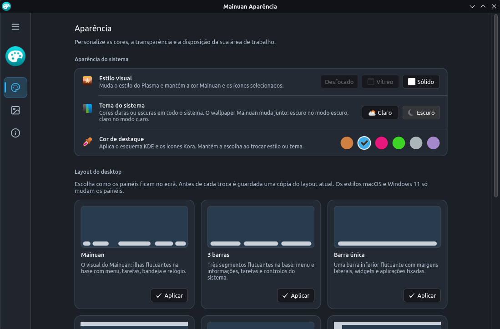
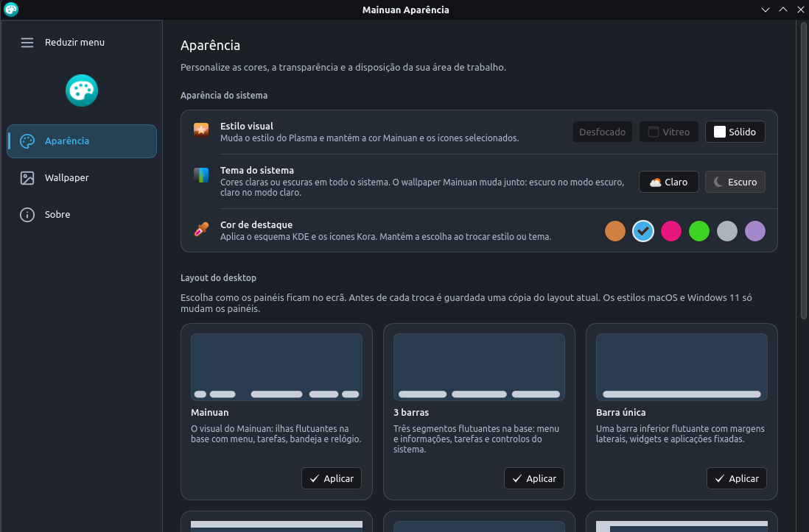
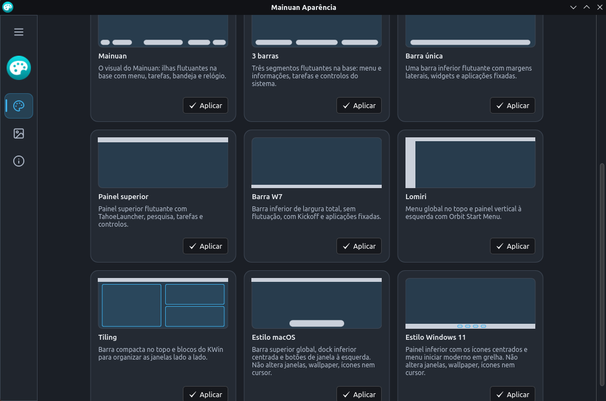

<div align="center">


# MAINUAN APARÊNCIA


Aplicação gráfica para personalizar o **KDE Plasma** na distribuição Mainuan: alterna entre tema **claro e escuro** (com o wallpaper Mainuan correspondente), escolhe a **cor de destaque** e o **estilo visual**, aplica um de **nove layouts de desktop** e gere os **wallpapers**.

</div>

## 📸 Screenshots

<div align="center">
  
  
  
</div>

## ✨ Funcionalidades

- **Tema claro/escuro:** muda o esquema de cores do sistema e aplica o wallpaper Mainuan_B ou Mainuan_C correspondente ao modo escolhido.
- **Cor de destaque:** seis cores à escolha (castanho, ciano, magenta, lima, cinzento e violeta), com o esquema de cores e o tema de ícones a acompanharem.
- **Estilo visual:** escolha do estilo visual do sistema.
- **Nove layouts de desktop:** Mainuan, 3 barras, Barra única, Painel superior, Barra W7, Lomiri, Tiling, Estilo macOS e Estilo Windows 11 (estes dois só alteram os painéis).
- **Wallpapers:** gestão do papel de parede do ambiente de trabalho.
- **Segue o sistema:** a janela acompanha o modo claro/escuro do sistema.
- **Barra lateral compacta:** só com ícones por defeito, com botão para expandir.
- **Multilingue:** português (PT), português (BR), inglês, francês e espanhol, escolhidos automaticamente pela língua do sistema.

## 📋 Requisitos

- Linux com **KDE Plasma** (Plasma 6 / Qt 6)
- Python 3
- PySide6 (módulos QtCore, QtGui, QtQml e QtQuick) e os módulos QML do Qt 6 e do Kirigami
- Recomendados: `plasma-workspace` e `libkf6kcmutils-bin`

As dependências são instaladas automaticamente pelo `apt` ao instalar o `.deb`.

## 📦 Instalação

Descarrega o ficheiro `.deb` mais recente na página de [Releases](../../releases) e instala:

```bash
sudo apt install ./mainuan-aparencia_1_1_1.deb
```

Depois abre **Mainuan Aparência** no menu de aplicações, ou executa no terminal:

```bash
mainuan-aparencia
```

## 🔧 Compilar o pacote a partir do código

```bash
git clone https://github.com/tugatechlabDC/mainuan-aparencia.git
cd mainuan-aparencia
dpkg-deb --root-owner-group --build package mainuan-aparencia_1_1_1.deb
```

## 📁 Estrutura do projeto

```text
mainuan-aparencia/
├── package/
│   ├── DEBIAN/                         # control e md5sums
│   └── usr/
│       ├── bin/                        # executável de arranque
│       └── share/
│           ├── mainuan-aparencia/
│           │   ├── python/             # código Python (app, backend, core, i18n)
│           │   ├── qml/                # interface QML e ícones
│           │   ├── layouts/            # scripts dos layouts de desktop
│           │   └── wallpapers/         # Mainuan_B.png e Mainuan_C.png
│           ├── applications/           # ficheiro .desktop
│           ├── metainfo/               # metadados AppStream
│           ├── icons/                  # ícones da aplicação
│           └── doc/                    # copyright e changelog do pacote
├── assets/screenshots/
├── CHANGELOG.md
├── LICENSE
└── README.md
```

## 🆕 Novidade da versão 1.1.1

Publicação do projeto no GitHub, com README, CHANGELOG, licença e screenshots. Vê o [CHANGELOG](CHANGELOG.md) para o histórico completo.

## 🙏 Créditos

- Baseado no **Mainuan Welcome 1.0** (ruscher), cujas páginas QML e layouts deram origem a esta versão independente.
- Ícones de linha no estilo [Lucide](https://lucide.dev) (licença ISC).

## 📄 Licença

Distribuído sob a licença **GPL-3.0 ou posterior**. Vê o ficheiro [LICENSE](LICENSE).

## 👤 Autor

**David Caixinha** — tugatechlaDC

## 🤝 Contribuição

Para reportar erros ou pedir funcionalidades, abre um [Issue](https://github.com/tugatechlabDC/mainuan-aparencia/issues). Para propor alterações, envia um pull request para o ramo `main` e regista qualquer alteração visível no [CHANGELOG.md](CHANGELOG.md).
